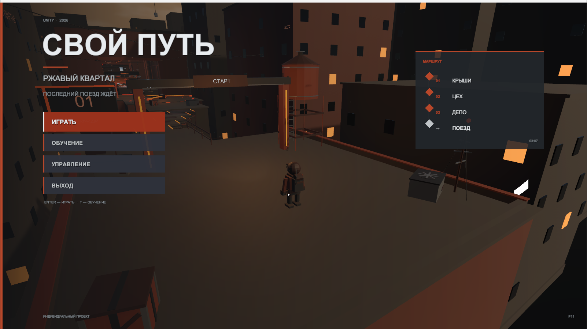
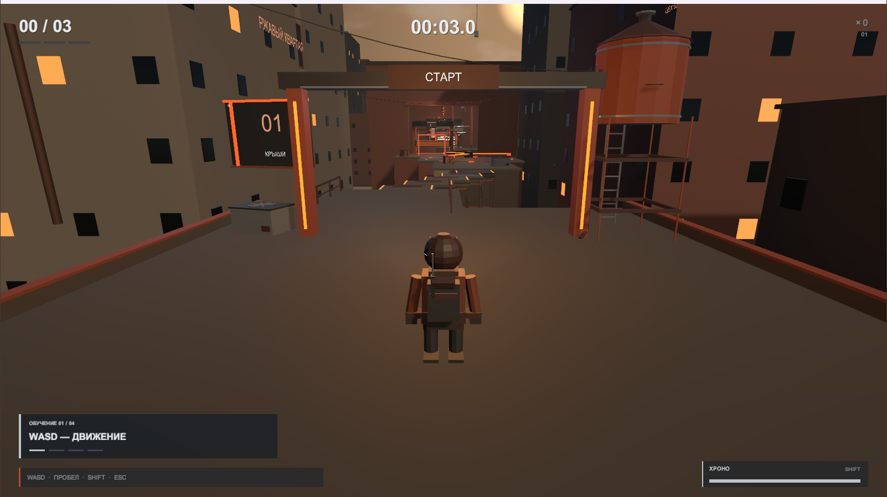
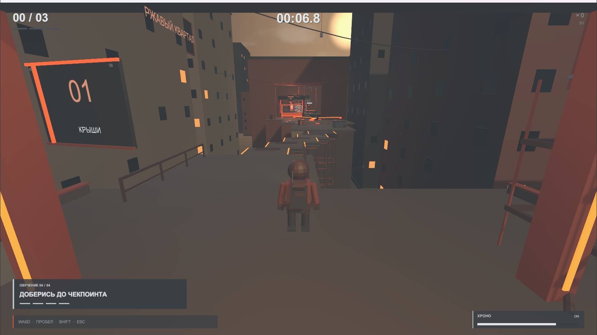
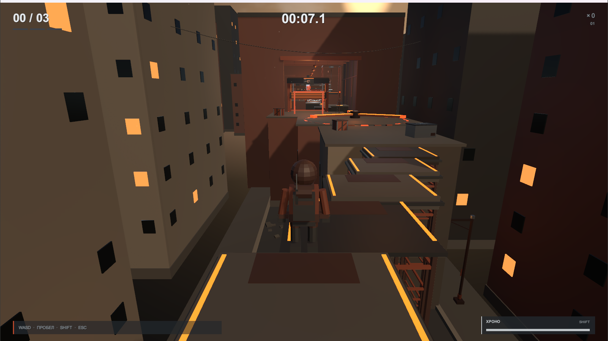
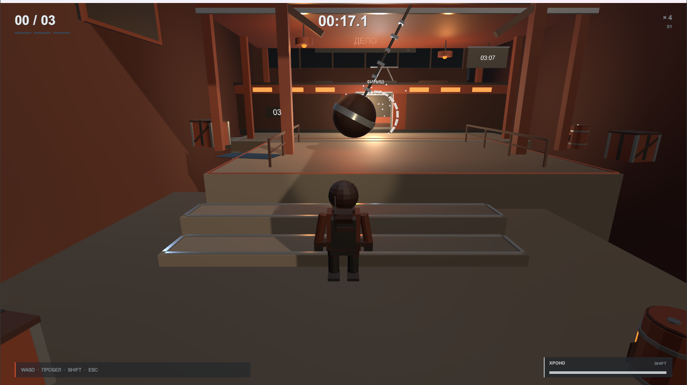

# Свой путь — «Ржавый квартал»

Учебный 3D-проект по Unity: играбельная полоса препятствий от старта до финиша. Действие происходит в заброшенном промышленном городе, где последний эвакуационный поезд уже стоит в депо. Игрок проходит три сектора — «Крыши», «Цех» и «Депо» — и должен успеть к вагону **03:07**.



## Быстрый запуск

1. Откройте `Build\SvoiPut.exe` (Windows 10/11, x64). Unity Editor не требуется.
2. В главном меню нажмите **«ИГРАТЬ»** (или Enter).
3. Дойдите до поезда в депо. Игра автоматически ставит паузу при потере фокуса окна.

Все ресурсы лежат рядом с исполняемым файлом. Сборка также запускается двойным щелчком по `SvoiPut.exe`.

## Управление

| Действие | Клавиша / мышь |
|---|---|
| Движение | **WASD** (относительно камеры) |
| Прыжок | **Пробел** (есть coyote-time и буфер ввода) |
| Вращение камеры | **Мышь** |
| Приближение / отдаление камеры | **Колесо мыши** |
| Хроно-модуль (замедление мира) | **Shift** (удерживать) |
| Пауза / продолжить | **Esc** |
| Начать игру из меню | **Enter** |
| Запустить обучение | **T** или кнопка «ОБУЧЕНИЕ» |
| Пройти заново на экране финиша | **R** |
| Полноэкранный режим | **F11** или **Alt+Enter** |

Подсказка по управлению всегда видна в нижней левой панели HUD.

## Обучение

Режим **«ОБУЧЕНИЕ»** — это не отдельная сцена, а пошаговый туториал поверх стартового участка трассы:

1. **WASD — ДВИЖЕНИЕ**: нужно пройти несколько метров.
2. **ПРОБЕЛ — ПРЫЖОК**: выполнить прыжок.
3. **SHIFT — ХРОНО**: включить замедление мира.
4. **ДОБЕРИСЬ ДО ЧЕКПОИНТА**: дойти до первой арки.

Каждый шаг подтверждается действием игрока, панель показывает прогресс `01 / 04`. После чекпоинта обучение завершается, таймер сбрасывается, и забег продолжается в обычном режиме.



## Механики

### Движение и прыжок
Персонаж управляется от третьего лица. Прыжок срабатывает отзывчиво на краю платформы благодаря coyote-time (0,12 с) и буферу ввода. Дальность прыжка позволяет преодолевать разрывы трассы до ~2,5 м; движущиеся платформы и лифт требуют дождаться удобного момента.

### Хроно-модуль — собственная механика
Удержание **Shift** замедляет мир до **0,42×**, но игрок продолжает двигаться в обычном темпе (движение и камера используют нескалированное время). Это помогает:

- разминуться с лопастями вентилятора и турбины;
- пройти между разрядами электрических дуг;
- успеть на движущуюся платформу или лифт;
- проскочить под прессом и маятниковым грузом.

Полного заряда хватает примерно на **3,8 секунды** замедления. После 0,65 с без использования энергия восстанавливается примерно за 6 секунд. При нуле заряда модуль блокируется до восстановления; шкала «ХРОНО» находится в правом нижнем углу.



## Препятствия

| Препятствие | Сектор | Как проходить |
|---|---|---|
| Обрушающиеся плиты | 01 · Крыши | Не останавливаться: плита мигает и исчезает на 2,6 с |
| Крышный вентилятор | 01 · Крыши | Пройти по краю или проскочить между лопастями (68°/с) |
| Гидравлический пресс | 02 · Цех | Дождаться предупреждающего света и удара, затем пройти |
| Движущиеся платформы | 02 · Цех | Дождаться платформы у края и ехать на ней |
| Грузовой лифт | 02 · Цех | Подняться на верхний ярус, переждать цикл |
| Электрические дуги | 02 · Цех | Проходить в паузах между разрядами; помогает хроно-модуль |
| Конвейер | 02 · Цех | Двигаться против ленты или перепрыгивать её |
| Патрульная машина | 03 · Депо | Пересечь арену, когда машина уехала в дальнюю сторону |
| Турбина на мосту | 03 · Депо | Узкий мост: проходить в окно между лопастями |
| Маятниковый груз | 03 · Депо | Проскочить под шаром в момент максимального отклонения |

Маршрут намеренно извилистый: площадки смещаются влево-вправо, поэтому трасса читается как S-образная, а не прямая.



## Маршрут

```
СТАРТ (крыша)
  └─ уход влево: Walkway01
      └─ обрушающиеся плиты по диагонали вправо
          └─ Landing01 → вентилятор на крыше
              └─ ЧЕКПОИНТ 01  (влево)
                  └─ пресс → движущаяся платформа A → карниз
                      └─ лифт на верхний ярус
                          └─ спуск на мост с дугами и конвейером
                              └─ ЧЕКПОИНТ 02  (влево)
                                  └─ арена с патрульной машиной
                                      └─ узкий мост с турбиной
                                          └─ ЧЕКПОИНТ 03  (вправо)
                                              └─ движущаяся платформа C
                                                  └─ финальная крыша → ступени → подиум
                                                      └─ станция → вагон 03:07 = ФИНИШ
```

## Чекпоинты, падения и финиш

- На трассе **три чекпоинта** (01, 02, 03) плюс стартовая площадка.
- При падении или касании опасного объекта игрок теряет управление, видит красную вспышку и причину ошибки («ПРЕСС», «МАШИНА», «ЭЛЕКТРИЧЕСКАЯ ДУГА» и т. д.), затем возвращается к последнему активированному чекпоинту.
- Счётчик ошибок увеличивается; активация чекпоинта подтверждается звуком, сменой цвета арки, всплывающей подсказкой и заполнением индикатора в HUD.
- На финише показывается экран победы с временем, числом падений и количеством активированных чекпоинтов.
- **«Пройти заново»** и **R** полностью перезапускают забег: сбрасываются чекпоинты, препятствия, таймер и счётчик падений.



## Обратная связь

- **HUD:** `00 / 03` и три индикатора чекпоинтов, таймер, счётчик ошибок, название сектора, цель, подсказки управления, шкала «ХРОНО».
- Всплывающие сообщения о старте, смене сектора, чекпоинтах и завершении обучения.
- Красная вспышка и панель с причиной при падении/уроне.
- Звуковые сигналы: прыжок, приземление, чекпоинт, ошибка, замедление, победа.
- Визуальные подсказки: мигающие плиты, предупреждающий свет пресса, разряды дуг, указатели секторов, шевроны направления.

## Сеттинг и интерфейс

- Заброшенный промышленный город: кирпич, бетон, ржавчина, ночное небо, редкие тёплые окна.
- Текста минимум: секторы, номера, короткие подсказки.
- Палитра интерфейса строго выдержана:
  - ржавый — `#B7472A`;
  - хром — `#BFC4C7`;
  - графит — `#20252B`.

## Модели из Blender

Девять моделей созданы процедурно в Blender 5.3 скриптом `Tools/Blender/build_models.py` и экспортированы в FBX:

| Модель | Где используется |
|---|---|
| `Survivor` | персонаж игрока (1,92 м) |
| `TrainCar` | последний поезд 03:07 |
| `PatrolCar` | патрульная машина на арене |
| `StreetLamp` | фонари улицы |
| `WaterTower` | водонапорная башня на стартовой крыше |
| `ACUnit` | вентиляционные блоки на крышах |
| `Crate` | ящики |
| `Barrel` | бочки |
| `IndustrialMachine` | восемь станков в цехе |

Пайплайн:

1. `blender.exe -b --factory-startup --python Tools/Blender/build_models.py` собирает девять FBX в `Assets/_Project/Models` и превью в `Tools/Blender/previews`.
2. `CourseBuilder.LoadModels()` загружает FBX, `PlaceModel()` ставит их в сцену, сохраняя осевой поворот FBX-корня, а материалы `M_*` заменяются проектными.
3. В сцене модели используются как есть — без сторонних ассетов и текстур.

## Технические детали

- **Unity:** 6000.3.12f1, Built-in Render Pipeline.
- **Платформа сборки:** Windows x64, Mono.
- **Сцена:** `Assets/_Project/Scenes/Game.unity` — генерируется редакторским скриптом.
- **Уровень:** `Assets/_Project/Editor/CourseBuilder.cs` (маршрут и системы), `CourseBuilder.City.cs` (город и крыши), `CourseBuilder.Obstacles.cs` (препятствия, цех, депо).
- **Интерфейс:** uGUI в рантайме (`UIManager.cs`), шрифт LegacyRuntime.
- **Звук:** синтезируется в рантайме (`AudioDirector.cs`).
- **Шейдеры:** `CitySkybox`, `AdditiveParticles`, `SmokeParticles`.

### Структура проекта

```
Assets/_Project/
  Editor/
    CourseBuilder.cs            — генерация сцены, маршрут, материалы, свет
    CourseBuilder.City.cs       — дома, крыши, улица, фонари
    CourseBuilder.Obstacles.cs  — пресс, вентиляторы, дуги, цех, депо, поезд
    BuildScript.cs              — сборка Windows и открытие сцены
  Scripts/
    Core/                       — GameSession, GameManager, AudioDirector
    Player/                     — PlayerController, PlayerCamera, TimeSlowAbility, PlayerVisual
    Level/                      — Checkpoint, FinishZone, Hazard, MovingPlatform, VanishingTile,
                                  RotatingSweeper, PulsingLaser, SwingingHazard, CrusherPiston,
                                  ConveyorBelt, SectionTrigger, CourseElement
    UI/                         — UIManager, UIColors, ButtonFx
  Models/                       — девять FBX из Blender
  Scenes/Game.unity
  Shaders/
  Materials/
Tools/Blender/build_models.py   — генератор моделей и превью
Build/                          — готовая Windows-сборка
docs/                           — презентация и скриншоты
```

## Сборка

В Unity: меню **«Свой путь → 2. Собрать Windows-сборку»**. Сцена пересоберётся автоматически, результат — `Build/SvoiPut.exe`.

Из командной строки:

```powershell
& "C:\Program Files\Unity\Hub\Editor\6000.3.12f1\Editor\Unity.exe" `
  -batchmode -quit -nographics -projectPath "C:\Users\gisp1\Projects\SvoiPut" `
  -executeMethod SvoiPut.EditorTools.BuildScript.BuildWindows `
  -logFile "build.log"
```

Пересобрать только сцену:

```powershell
  -executeMethod SvoiPut.EditorTools.CourseBuilder.BuildAll
```

## Проверка проекта

- Меню, запуск игры и обучения, движение, прыжок, хроно-модуль и пауза проверены в собранном exe.
- Пройдены все шаги обучения: WASD → ПРОБЕЛ → SHIFT → чекпоинт.
- Проверены возврат на чекпоинт после падения и после касания препятствия, счётчик ошибок и сброс прогресса.
- Проверены размеры и ориентация всех девяти FBX-моделей после импорта.
- Проверена геометрия маршрута по секциям: разрывы и перепады высот проходимы.

## Материалы задания

- `README.md` — описание, запуск, управление и сборка.
- `Build/SvoiPut.exe` — готовая Windows-сборка.
- `docs/Презентация.pptx` — презентация проекта (8 слайдов).
- `docs/img/` — скриншоты для отчёта.
